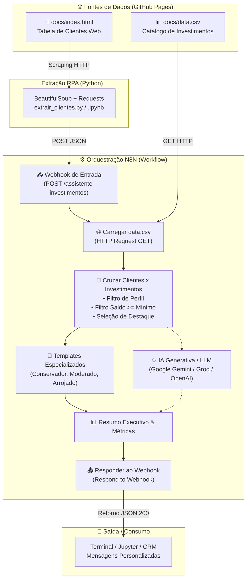

# 🤖 Assistente de Investimentos com RPA e IA Generativa

> **Projeto desenvolvido para o desafio da Digital Innovation One (DIO):** *Criando um Assistente de Investimentos com RPA e IA Generativa*.

---

## 📌 Visão Geral do Projeto

Este projeto implementa um pipeline inteligente de assessoria de investimentos ponta a ponta, simulando o cenário real de uma instituição financeira ou fintech.

O fluxo combina **RPA (Robotic Process Automation)** em Python para extrair dados cadastrais de clientes de uma página web legada, orquestração via **N8N**, enriquecimento dinâmico cruzando com o catálogo de investimentos (`data.csv`) e geração de recomendações financeiras personalizadas — tanto via **Templates Dinâmicos com Regras de Negócio (MVP)** quanto via **IA Generativa / LLM (Desafio Completo)**.

---

## 🏗️ Arquitetura da Solução



---

## 🛠️ Tecnologias e Ferramentas

| Etapa | Ferramenta | Finalidade |
|---|---|---|
| **Hospedagem de Dados** | GitHub Pages | Servir a tabela simulada de clientes e a base CSV de investimentos |
| **Extração RPA** | Python 3 + BeautifulSoup4 + Requests | Coleta automatizada dos clientes a partir do DOM HTML |
| **Orquestração** | N8N (Local ou Cloud) | Recebimento via Webhook, integração HTTP e cruzamento de dados |
| **Regras Financeiras** | JavaScript (N8N Code Node) | Sanitização de moeda (`BRL`), filtro de perfil e validação de aporte mínimo |
| **Geração com IA** | Agente de IA / LLM (Gemini / Groq / OpenAI) | Redação humanizada, empática e contextualizada das recomendações |

---

## 📁 Estrutura do Repositório

```text
dio-lab-assistente-investimentos-rpa-n8n/
├── README.md                      # Documentação completa do projeto
├── requirements.txt               # Dependências Python (requests, beautifulsoup4)
├── docs/
│   ├── index.html                 # Página simulada com tabela de clientes
│   └── data.csv                   # Catálogo de investimentos (perfil, produto, mínimo, taxa)
├── src/
│   ├── extrair_clientes.py        # Script Python CLI com suporte a argumentos e logs
│   └── extrair_clientes.ipynb     # Notebook Jupyter/Colab com envio para o Webhook implementado
├── rpa/
│   ├── extrair_clientes.py        # Cópia para compatibilidade com a estrutura DIO
│   └── extrair_clientes.ipynb     # Cópia para compatibilidade com a estrutura DIO
└── n8n/
    ├── workflow.json              # Workflow principal pronto para importação
    ├── workflow_mvp.json          # Versão MVP: 100% plug & play (regras e templates sem API key)
    └── workflow_ai.json           # Versão Desafio: Nó de IA Generativa conectado (Gemini / LLM)
```

---

## 🚀 Como Executar o Projeto

### 1. Configurar o N8N

Você pode utilizar tanto o **N8N Local** quanto o **N8N Cloud**:

1. No N8N, clique em **Add Workflow** -> menu de 3 pontinhos (`...`) no canto superior direito -> **Import from File...**.
2. Selecione o arquivo:
   - Para o **MVP** (sem necessidade de chaves de API externas): importe `n8n/workflow_mvp.json` (ou `n8n/workflow.json`).
   - Para o **Desafio com IA**: importe `n8n/workflow_ai.json` e configure sua credencial do Google Gemini, Groq ou OpenAI.
3. Obtenha a URL do Webhook:
   - Dê um duplo clique no nó **Webhook - Clientes**.
   - Para testar no editor: copie a **Test URL** (ex: `http://localhost:5678/webhook-test/assistente-investimentos`) e clique no botão **Listen for test event**.
   - Para rodar continuamente: ative o toggle do workflow no topo direito para **Active** e copie a **Production URL** (ex: `http://localhost:5678/webhook/assistente-investimentos`).

---

### 2. Executar o Script RPA em Python

#### Opção A: Via Terminal (Script `.py`)

1. Instale as dependências:
   ```bash
   pip install -r requirements.txt
   ```

2. Modo Apenas Extração (Dry-run):
   ```bash
   python src/extrair_clientes.py --dry-run
   ```

3. Executar RPA e enviar ao Webhook N8N:
   ```bash
   python src/extrair_clientes.py --webhook "http://localhost:5678/webhook/assistente-investimentos"
   ```

#### Opção B: Via Google Colab / Jupyter Notebook (`.ipynb`)

1. Abra `src/extrair_clientes.ipynb` no [Google Colab](https://colab.research.google.com/) ou VS Code.
2. Execute a célula 1 para instalar as bibliotecas (`!pip install requests beautifulsoup4`).
3. Execute a célula 2 para extrair os 10 clientes da página web.
4. Na célula 3, informe a sua URL do Webhook do N8N na variável `N8N_WEBHOOK` e execute para enviar os dados e receber as mensagens formatadas!

---

## 💡 Regras de Negócio e Decisões Técnicas

### 1. Sanitização do Saldo
O campo de saldo na tabela HTML vem como string brasileira (ex: `"R$ 12.500,00"` ou `"R$ 850,00"`). O script/workflow aplica regex para converter em float puro (`12500.00` e `850.00`), viabilizando comparações numéricas com o valor mínimo de aporte.

### 2. Cruzamento Dinâmico com `data.csv`
O workflow lê a base remota de investimentos via nó HTTP Request. Cada cliente tem seu perfil confrontado com a base:
- **Conservador**: Filtra por Poupança (mín. R$ 100), CDB Liquidez Diária (mín. R$ 1.000) e Tesouro Selic (mín. R$ 500).
- **Moderado**: Filtra por CDB Prefixado (mín. R$ 1.000), Fundo Multimercado (mín. R$ 5.000) e Tesouro IPCA+ (mín. R$ 1.000).
- **Arrojado**: Filtra por Ações ETF (mín. R$ 500), Fundo de Ações (mín. R$ 10.000) e Criptomoedas (mín. R$ 100).

### 3. Validação de Aporte Mínimo
Clientes cujo saldo não atinge o mínimo de produtos mais arriscados (como *Daniel Oliveira* com R$ 850,00 ou *Isabela Martins* com R$ 500,00) só recebem como opções elegíveis os produtos que eles realmente conseguem aplicar, além de orientações para planejar os próximos aportes.

### 4. Resiliência e Fallback
Se a página do GitHub Pages ou o CSV estiverem offline ou instáveis, o workflow conta com um fallback integrado das opções de investimento no próprio nó de código, garantindo que o pipeline nunca falhe silenciosamente.

---

## 📊 Exemplos de Mensagens Geradas

### Exemplo 1: Perfil Conservador
> **Cliente:** Ana Silva | Saldo: R$ 12.500,00
```text
Olá, Ana!
Identificamos seu perfil Conservador com saldo disponível de R$ 12.500,00.
Para quem prioriza segurança, previsibilidade e reserva de emergência com liquidez diária, selecionamos as seguintes opções adequadas à sua carteira:

• Poupança (Aporte mín.: R$ 100,00 | Rentabilidade: 6.2%)
• CDB Liquidez Diária (Aporte mín.: R$ 1.000,00 | Rentabilidade: 12.5%)
• Tesouro Selic (Aporte mín.: R$ 500,00 | Rentabilidade: 13.0%)

💡 Destaque da Assessoria: CDB Liquidez Diária com rentabilidade de 12.5%.
Uma excelente alternativa para proteger seu patrimônio com ganhos acima da poupança tradicional.

*Aviso legal: Rentabilidade passada não é garantia de resultados futuros. Consulte sempre seu assessor.*
```

### Exemplo 2: Perfil Moderado
> **Cliente:** Bruno Lima | Saldo: R$ 3.200,00
```text
Olá, Bruno!
Identificamos seu perfil Moderado com saldo disponível de R$ 3.200,00.
Seu perfil busca a combinação ideal entre segurança patrimonial e ganhos reais acima da inflação no médio prazo.

• CDB Prefixado (Aporte mín.: R$ 1.000,00 | Rentabilidade: 14.0%)
• Tesouro IPCA+ (Aporte mín.: R$ 1.000,00 | Rentabilidade: IPCA+6.0%)

💡 Destaque da Assessoria: Tesouro IPCA+ com rentabilidade de IPCA+6.0%.
A diversificação entre crédito privado e títulos indexados ao IPCA potencializa sua rentabilidade mantendo o risco equilibrado.

*Aviso legal: Rentabilidade passada não é garantia de resultados futuros. Avalie seus objetivos de médio prazo.*
```

### Exemplo 3: Perfil Arrojado
> **Cliente:** Carla Souza | Saldo: R$ 28.900,00
```text
Olá, Carla!
Identificamos seu perfil Arrojado com saldo disponível de R$ 28.900,00.
Investidores arrojados toleram volatilidade em troca de expressivo potencial de valorização no longo prazo.

• Ações ETF (Aporte mín.: R$ 500,00 | Rentabilidade: Variável)
• Fundo de Ações (Aporte mín.: R$ 10.000,00 | Rentabilidade: Variável)
• Criptomoedas (Aporte mín.: R$ 100,00 | Rentabilidade: Variável)

💡 Destaque da Assessoria: Fundo de Ações (Rentabilidade: Variável).
Alocar em renda variável e fundos possibilita capturar o crescimento das maiores empresas do mercado.

*Aviso legal: Ativos de renda variável possuem oscilação de cota e risco de perda. Mantenha foco no longo prazo.*
```

---

## 🏆 Checklist de Entregáveis

### MVP (Mínimo Viável)
- [x] Repositório estruturado conforme o padrão da DIO
- [x] Script RPA Python integrado ao Webhook do N8N (`extrair_clientes.py` e `.ipynb`)
- [x] Workflow N8N com leitura de `data.csv` e cruzamento de perfis (`n8n/workflow_mvp.json` e `n8n/workflow.json`)
- [x] Templates dinâmicos especializados por perfil de investidor

### Desafio Completo (IA Generativa)
- [x] Todos os itens do MVP
- [x] Workflow N8N com suporte a Agente de IA / LLM (`n8n/workflow_ai.json`)
- [x] Prompt contextualizado com saldo, perfil e produtos elegíveis
- [x] Documentação técnica completa explicando a arquitetura e decisões de projeto

---

## 📜 Licença

Distribuído sob a licença MIT. Consulte `LICENSE` para mais informações.
